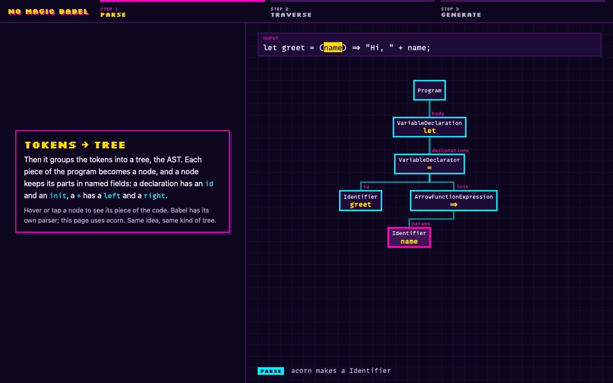
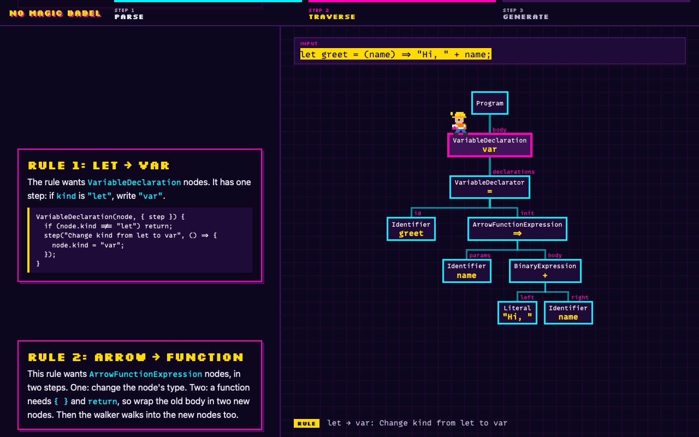
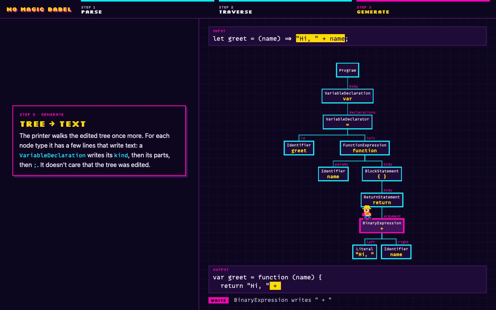

<div align="center">

# No magic in Babel

**There is no magic in Babel** — a tiny compiler that builds a tree, edits it with rules people wrote, and prints it back, told as a scroll story.<br>
Watch every step happen to one line of code.

### [▶ Scroll the story at babel.avolkov.dev](https://babel.avolkov.dev)

Best in Safari on a Mac. Works on a phone.

<!-- Happy-path video: drag /private/tmp/claude-501/-Users-alex-Downloads-github/eba4b07d-fb10-47d6-8ce4-42740ad111e8/scratchpad/media/no-magic-babel/happy-path.mp4 onto this line in the GitHub editor -->

  

</div>

## The story

Babel turns new JavaScript into old JavaScript. It looks smart, but it doesn't understand code. It builds a tree, edits the tree and prints it back as text, following rules that people wrote, step by step. This repo is a compiler that does the same, in about 300 lines of TypeScript, and a page that shows every step.

1. **Parse: text → tree.** [acorn](https://github.com/acornjs/acorn) cuts the text into tokens and builds a tree of plain objects, the AST. Babel has its own parser; the idea is the same.
2. **Traverse: walk the tree, let the rules edit it.** The walker enters every node, goes into its children and leaves. It knows only where each node type keeps its children. A rule names the node type it wants and changes it in small, named steps.
3. **Generate: tree → text.** The printer walks the edited tree and writes a few characters for each node.

```js
let greet = (name) => "Hi, " + name;
```

becomes, with the rules `let → var` and `arrow → function`,

```js
var greet = function (name) {
  return "Hi, " + name;
};
```

the same output as Babel's own plugins.

**Not almighty.** The arrow rule in `src/rules/arrow-functions.ts` has two steps and no idea what `this` means, so it breaks `this.read = () => this.count`. `src/rules/arrow-functions-this.ts` adds the two steps Babel uses (`var _this = this`). Nothing guesses: a node type the walker or the printer has no lines for stops with an error, e.g. `I don't know how to print a ClassDeclaration`.

## How it was checked

The code was written with Claude Code. An independent judge checked it: the tests parse every output with acorn in ES5 mode (if it parses, it is old JavaScript) and run input and output in a fresh VM to see that they do the same thing.

| File | What it does |
|---|---|
| `src/parse.ts` | text → tree, with acorn |
| `src/traverse.ts` | the walker, and the list of where each node type keeps its children |
| `src/rules/*.ts` | the rules, written as steps |
| `src/generate.ts` | tree → text |
| `src/demo.ts` | `npm start`: the three steps in the terminal |
| `tests/compile.test.ts` | the judge |
| `site/` | the scroll story: `record.ts` runs the real compiler once and keeps every moment as a frame, `tree.ts` draws the frames |
| `scripts/share-card.mjs` | makes the link-preview card and the home-screen icon from the page (needs Playwright) |

## Run it locally

Needs Node 24 or newer.

```sh
git clone --depth 1 https://github.com/slimcandy/no-magic-babel.git
cd no-magic-babel
npm install
npm start      # the three steps, printed
npm test       # the judge
npm run dev    # the page, at http://localhost:5173/
```

## Licence

Code: MIT, © 2025–2026 Aleksei Volkov. It started from Mohammad Taheri's article [Write your own Babel](https://mohammadtaheri.medium.com/write-your-own-babel-54ab880f1dfd). The page's pixel font is [Silkscreen](https://fonts.google.com/specimen/Silkscreen) by Jason Kottke (SIL Open Font License); the code font, MonoLisa, is licensed and fetched at build time, never committed.
